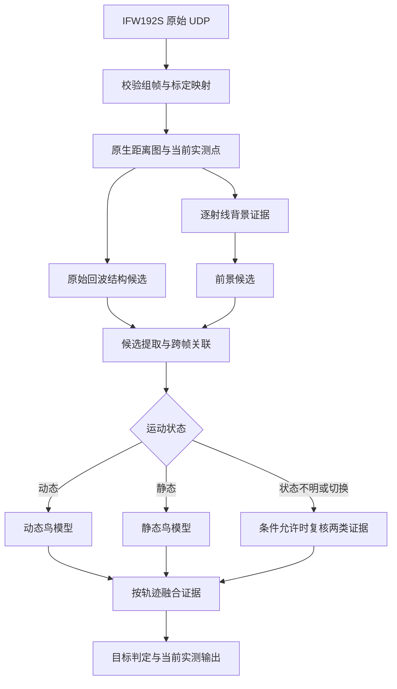

# IFW192S 鸟类识别算法设计哲学

**先判断目标是动态、静态，还是暂时无法确定，再分别用动态鸟模型和静态鸟模型判断，最后在同一条轨迹上融合证据。** 飞来、停栖、再次起动，可能是同一只鸟在不同时间的观测状态。它移动时，主要看连续几帧里目标怎样移动。它停下时，主要看同一位置是否持续出现符合鸟体的空间结构。证据不足时保留 `UNKNOWN`。

本文以 2026 年 11 月 3 日原始开发计划为起点。双分支是当前的设计目标，ESP32-S3 实时固件已实现距离图前端、几何候选、前景跟踪和锁定后重检。独立的动静状态分类、两套鸟类判定模型和语义融合仍需实现与验证。

**当前固件无法独立识别从头静止的鸟。** 为降低防鸟刺、支撑物等形状相似的静态物体被误锁的风险，新锁定必须有位移证据。鸟从第一次观察起就静止且未达到位移门槛时，即使提取出形状相符的候选，也无法建立锁定。先满足条件被锁定、后来停下的目标，可以依靠当前帧实测回波续接原轨迹。这部分能力属于轨迹保持。独立的静态鸟识别仍在设计与验证阶段。

## 1. 当初要解决什么问题

原计划面向固定安装的 IFW192S 和 RK3588，先研究近距离停栖或缓慢活动的鸟。实验要覆盖只有鸟、只有防鸟刺、鸟刺同框，以及刺在风中晃动等条件。开发顺序是先核对采集和标定，再用同一帧的二维距离图和三维点云检查鸟体是否可见，比较背景和候选提取方式，最后评估几何、轻量模型、时序和板端开销。试验距离是采样条件，适用距离须由独立数据确定。飞行鸟和鸟种识别超出原计划的首轮验证范围。

这个问题难在运动和形状各有盲区。风吹防鸟刺会制造前景，鸟停下来后位移会趋近于零。鸟与刺接触或部分遮挡时，单帧点集还可能粘在一起。设计上先问「这个候选的运动状态能判断吗」，再问「在这个状态下，哪些实测证据支持它是鸟」。2026 年 11 月的静止鸟和运动特征离线实验沿这两个问题分别展开。ESP32-S3 的部署工作随后加入内存、吞吐和延迟约束。

## 2. 设计目标的数据流



「模型」在这里指一套能从证据得到判定的规则或轻量分类器。两路可共用候选几何、关联和输出结构，分别确定所需特征和拒识条件。图中的原始回波结构候选包括设计中的静态起始检测。当前固件只在已锁定轨迹需要续接时，从其附近的原始回波重检。

### IFW192S 距离图

用扫描方向为索引，把每帧组织成 **256 列 × 192 通道**的原生距离网格，共 49,152 个采样格。格子表示一条标定射线，实际有效回波数随场景变化。前端读取包序、帧边界、`ring`、`column` 和测距字段，检查缺包、重复以及异常记录；用标定把有效回波换算成距离和三维坐标，保留帧号、格的位置和帧内源行 `source_row`。实测有效性随格记录，缺测与超出工作区分别处理。二维网格用于低成本邻域扫描和背景差分，候选需要物理尺寸、形状和空间关系时再使用同源三维点。对应实现见 [UDP 解包与组帧](../firmware/esp32s3_ifw192s/wire.hpp)、[网格输入](../firmware/esp32s3_ifw192s/grid_input.hpp)和[跟踪接口](../firmware/esp32s3_bird_core/grid_algorithm.hpp)。

### 背景建模与保护

背景回答的是「这条射线在此处通常看到什么」，它为前景筛选提供证据。原计划保留三种对照。

| 原计划对照 | 做法 | 要检验的问题 |
| --- | --- | --- |
| B0 | 用明确无鸟的样本，按射线计算距离中位数和中位绝对偏差（MAD） | 固定背景的中心距离和正常波动能否稳定估计 |
| B1 | 用含晃动防鸟刺的无鸟样本，为同一射线建多个距离分布 | 能否减少晃动刺产生的前景，同时保留邻近鸟体回波 |
| B2 | 从原始距离图或点云提取候选，绕开前景掩码 | 鸟已停栖、与背景重叠或开机前已在场时，结构证据能否找到它 |

**背景保护针对停栖和慢动目标。** 如果以后引入在线背景更新，已关联候选、停栖轨迹及动静切换区应暂缓更新。目标离开后，须有连续有效回波支持原背景恢复，再开放相应射线更新。背景缺失、遮挡和鸟刺混合区需保留不确定性。若开机时鸟已在场，单凭同一份被污染的背景无法判断该区域是否为空，可用独立的无鸟参考或原始回波结构候选复核。

当前实时固件先收集 10 个完整输入帧，再冻结逐射线背景。有效样本达到最低数量时，通常取较低中位数。距离的 P90 与 P10 之差超过 0.15 米时，取样本中最远回波。前景筛选要求回波处于工作距离内。若该射线已有背景，当前回波须比背景近超过 0.10 米。它实现了固定背景与局部重检的基线，在线按轨迹保护更新、B1 多分布背景和 B2 独立静态起始候选仍属设计或历史对照。对应实现见 [实时跟踪器](../firmware/esp32s3_bird_core/tracker.cpp)。

### 候选提取与关联

前景候选先在原生网格寻找连通区域，再用深度角和三维点间距离分离局部结构。点数、包围尺寸、占用和协方差形状等约束用于剔除几何证据不足的区域。静态起始路径的目标是在原始网格上保留可能被背景掩码压掉的结构，再用局部三维几何复核。细长支撑物与鸟体相连时，需要检查分割或邻域关系。无法可靠分开的区域保留混合或 `UNKNOWN`。对应实现见 [候选几何](../firmware/esp32s3_bird_core/geometry.cpp)。

用候选的实测位置、连续性和局部形状进行跨帧关联，再把相邻的候选观测交给运动状态判断。候选只表示一组值得检查的实测回波。同一轨迹应有可追溯的帧号、候选格和源行；点集碎裂、粘连或交换归属时，应暂停累计相关运动证据。预测位置可用于限定下一帧搜索区域，当前帧位置和点集须来自当前有效回波。

## 3. 状态分类先于鸟类分类

运动状态针对**已经关联的候选轨迹**，按短时窗口评估。位移和速度必须结合实际帧间隔、距离、观测点数以及该位置的测量抖动来解释。建议用持续时间和滞回处理动静切换，由进入条件确认状态，由独立的退出条件抑制单帧波动；窗口与阈值应在开发集确定并冻结。

| 运动状态 | 实测条件 | 路由 |
| --- | --- | --- |
| 动态 | 有足够的连续测量，位置变化超过抖动范围，且有证据支持连续候选属于同一目标 | 动态鸟模型为主，几何检查辅助 |
| 静态 | 目标持续有回波，位置变化在静止容差内，局部结构和位置有可重复的支持 | 静态鸟模型为主，保留之前的可用轨迹历史 |
| 状态不明或切换 | 窗口太短、缺帧、遮挡、粘连、关联冲突，或处于起落和动静切换边界 | 有足够证据的分支可作复核，条件不足时保留 `UNKNOWN` |

同一射线距离变化说明回波与背景不同。判断物体是否移动，要根据一段连续轨迹。现有固件中的 `Dynamic` 表示该次匹配来自前景候选，`Retained` 表示通过局部当前回波重检续接。两者记录的是匹配来源。显式的动态、静态和不确定状态仍需单独建立。对应定义见 [跟踪结果结构](../firmware/esp32s3_bird_core/bird_tracker.hpp)和[前景关联及局部重检](../firmware/esp32s3_bird_core/tracker.cpp)。

## 4. 动态鸟模型看运动证据，静态鸟模型看空间结构

### 动态分支

动态分支优先回答「是否有一个可持续关联的、具有鸟体几何支持的目标在移动」。用只包含当前和历史实测的短窗口检查净位移、累计路程、速度变化、方向连续性、覆盖时长和局部点集变化。抖动、遮挡或缺帧造成的间隔会降低证据权重。轨迹连续性首先用于确认这些特征来自同一候选；仅凭速度或连续位移没有足够依据区分鸟和移动支撑物。

抗干扰结合运动和空间上下文。绕固定支撑局部往复、运动范围很小或结构长期仅由细长支撑构成时，可降低鸟体证据。对鸟与支撑一起移动的情况，需要检查候选内部的空间结构，避免把共同位移归为鸟体独有的行为。风吹刺、摇动支撑、近处遮挡和稀疏噪声应各自有对照。历史动态离线探针在 11 段开发录制中只有 24 个候选观测能计算 1 秒特征，全部出自同一段混合录制且身份未确认；没有可计算的 2 秒窗口。该结果提示应先验证候选连续性，再评估运动特征能否区分目标与干扰。

当前实时固件实现了前景候选的空间关联。候选建立新锁定前，须通过几何和其他锁定条件，轨迹累计至少命中 5 次，且实测质心相对初始位置的最大位移至少为 4.5 厘米。实测质心也会因遮挡、点集变化或关联错误产生表观位移，静态相似物的实际误报率仍需验证。速度、方向、往复行为及短窗一致性仍是拟验证的动态分支特征。对应实现见 [锁定条件](../firmware/esp32s3_bird_core/tracker.cpp#L371-L396)。

### 静态分支设计与当前停栖续接

静态分支回答「这个位置是否持续存在符合鸟体的空间结构」。对当前实测点检查三维长宽高、主轴比例、点集紧凑度、原生距离图的局部轮廓，以及目标与附近防鸟刺和支撑物的连接关系。只有足够的实测点支持时才使用这些特征。距离、姿态和遮挡会改变可见形状，几何规则需覆盖被部分挡住的目标和形状相似的负例。

静态分支设计需要应对两种停栖场景。**运动后停栖**时，目标可沿原轨迹做局部重检，由连续的形状证据接续判定。**从首次观测起就停栖**时，包括开机前已在场的鸟，需要独立静态候选入口，结合原始回波、可靠的无鸟参考或局部结构发现目标。启用静态起始检测前，应先验证规则能否区分鸟体与相似的静止防鸟刺、支撑物等干扰，并检查背景保护效果。

**当前实现只有锁定后的局部重检。** 当前景关联失败时，已锁定轨迹才会在附近搜索新的实测候选。当前帧回波通过共享几何和关联检查后，可沿用原 ID；当前帧缺少匹配时，结果中不输出该轨迹的实测框。从未锁定的候选没有这条续接路径，持续静止且未达到位移门槛的鸟目前会漏检。对应实现见 [局部重检与锁定输出](../firmware/esp32s3_bird_core/tracker.cpp#L353-L396)。

## 5. 融合在同一条轨迹上完成

融合层接收两路证据的适用状态、质量、时间范围和来源。它先确认两路证据是否属于同一轨迹，再结合状态与连续观测给出一次判定，避免双路重复计数。两路使用同一批实测点时，应记录证据相关性。分数需要经过校准才可作概率解释，规则阈值和融合窗口由冻结前的开发验证确定。

| 场景 | 目标融合规则 |
| --- | --- |
| 连续运动或持续停栖 | 以当前状态对应分支为主，用另一分支可用的几何或轨迹信息补充 |
| 从运动到停栖，再重新起动 | 可靠关联时延续轨迹 ID；有界保留切换前的鸟体证据，由切换后的连续实测接续确认 |
| 两路支持同一目标 | 共享一个轨迹 ID 和判定，输出该帧实测支持的中心、框和点集来源 |
| 两路冲突、状态难判或观测不够 | 检查关联、遮挡、点数和背景质量，等待新证据或输出 `UNKNOWN` |
| 当前缺测或输入失效 | 可以在限定时间内保留待复核的轨迹历史，清除当前实测框；按情况输出 `UNKNOWN` 或 `SENSOR_STALE` |

原计划的输出契约包含 `BIRD`、`NO_BIRD`、`UNKNOWN` 和 `SENSOR_STALE`。`BIRD` 需满足冻结后的鸟体判定条件。`NO_BIRD` 需要有效覆盖和适用场景下的有效排查。证据不足或链路无新数据分别用后两种状态表达。当前固件输出 `warmup`、`active`、`UNKNOWN` 以及候选数和实测锁定轨迹。`active` 表示正在处理有效输入，锁定表示跟踪器接受了当前候选。轨迹 JSON 输出 ID、框、中心和点数，逐点源行保留在计算内部。现有的前景优先、锁定后局部重检和轨迹去重提供了工程基础，完整语义融合仍待实现。对应实现见 [实时 JSON 输出](../firmware/esp32s3_ifw192s/live_probe/main/main.cpp)和[看板桥接](../deploy/s3_rk3588/viewer.py)。

## 6. ESP32-S3 双缓冲流水线

### W6300 目标架构

2026 年 11 月 20 日架构稿规划由 W6300 接收 IFW192S 的以太网 UDP，ESP32-S3 通过 QSPI 读取。核 0 独占网口读取、包校验和组帧，把整帧写入 PSRAM 的 A/B 网格之一。核 1 独占跟踪器和算法工作区，按帧顺序读取就绪网格，执行背景、候选、关联、分支判定和融合，再把当前结果传给输出环节。RK3588 通过 USB 接收结果，承担展示和保存。

```text
IFW192S → W6300 硬件 UDP → QSPI → 核 0 接收、解包及组帧
                                        ↓ 帧号及 A/B 槽编号
                                 PSRAM 帧槽 A / B
                                        ↓ 就绪队列
                                 核 1 跟踪及判定 → USB → RK3588 看板
```

槽的所有权按「空闲 → 填充 → 就绪 → 处理中 → 空闲」交接。核 1 使用上一帧时，核 0 可以填另一槽。就绪队列深度为 1，无空槽或队列满时丢弃该输入帧并分别计数，继续接收后续包。受损帧按帧号记录完整性和不确定状态，恢复时重新核对帧序及轨迹状态。双缓冲让不同帧的接收与计算重叠；同一帧仍按算法依赖处理，跨帧跟踪状态按顺序更新。

### 当前 W5500 实现

仓库固件和 2026 年 11 月 21 日部署记录使用 **W5500**。收包侧使用两块片内 SPI DMA 缓冲，在读取下一批数据的同时解析上一批。整帧交接另有两块 PSRAM 打包输入槽和一个深度为 1 的就绪队列。核 1 的跟踪任务从槽中生成自己的工作网格，随后归还输入槽，再执行算法。这样接收任务可以复用已归还的槽，跟踪器继续使用独立工作区。实时模式遇到帧序不连续会清理轨迹并保留已建背景；不完整帧若进入处理队列，可输出 `UNKNOWN`。因为无槽或队列满而未交付的输入由对应计数反映。实现见 [在线收包与跟踪任务](../firmware/esp32s3_ifw192s/live_probe/main/main.cpp)和 [RK3588 部署说明](../deploy/s3_rk3588/README.md)。

W6300 仍需验证驱动、真实包流下的吞吐、与 SDK 的逐帧网格一致性、故障恢复、持续运行和内存余量。11 月 20 日架构稿把「末包到达网口至结果就绪」每帧不超过 100 ms 设为目标。若只能测到 S3 读出末包的时刻，应单独报告「末包读出至结果就绪」，端到端传感器到浏览器延迟需另测。

## 7. 已实现与待验证

| 环节 | 已实现或已观察 | 待实现或待验证 |
| --- | --- | --- |
| 距离图前端 | W5500 实时接收、UDP 校验与组帧、标定网格和当前实测来源 | W6300 接入后与 SDK 核对帧边界、有效格、XYZ 和源行，以及缺包、重复和乱序恢复 |
| 背景与候选 | 10 帧预热背景、前景掩码、深度角分割及几何筛选 | B0/B1/B2 对照、静态候选对背景掩码的依赖和防止停栖目标被吸收的更新规则 |
| 动态识别 | 前景关联、位移锁定门槛；曾进行离线运动特征诊断 | 显式动静状态、运动特征的独立判别能力、晃刺和移动支撑对照 |
| 停栖续接与静态识别 | 已锁定目标可用当前回波局部重检；新目标必须满足位移门槛 | 从首次观测起就静止的鸟的独立检出，以及对相似静态物体的拒识 |
| 融合与输出 | 共用跟踪 ID、前景优先与重检续接、当前帧实测框、缺测状态 | 动静切换的身份和判定连续性、双路冲突处理、语义 `BIRD` 和 `NO_BIRD` 的验收 |
| 板端流水线 | W5500 双缓冲、ESP32-S3 板上跟踪及 RK3588 显示；模型鸟试验观察到持续锁定，也有丢失 | W6300 的实流验收、长期运行、满负荷丢帧和端到端延迟 |

一次 2026 年 11 月 21 日 W5500 模型鸟试验记录了 332,050 个入站包，包序统计未发现缺包，组帧端计得 431 个完整输入帧，输出 385 个活动帧及 10 个预热帧。全段另有 4 次无缓冲、24 次就绪队列满及 8 次背景构建期间跳过。385 个活动输出的「末包读出至结果就绪」P95 为 103.94 ms。锁定出现于其中 189 帧。这些数值描述该次实流的传输、处理和锁定现象，现场独立召回率、误报率、真实鸟准确率及适用距离仍待测量。原始统计位于本机 `data/s3_cam_sync_20261121_03/live_w5500_timing.json`。数据划分和标注口径见[数据说明](../data/README.md)。

验证应从原始录制到融合输出逐级对账。用无鸟空场、静止和晃动防鸟刺、移动支撑、开机已在场的静止目标、移动到停栖再起动及鸟刺同框等场景，分别检查前端候选保留、动静状态、分支判定和事件输出。相同输入和配置下对照「仅动态」「仅静态」「分流并融合」，并检查背景保护开关对误报、漏检和事件碎裂的影响。按会话、物理摆位与个体分组，冻结参数后用独立数据报告事件召回、单位时间误报数、`UNKNOWN` 比例、锁定连续性与进入／离开延迟。没有可信目标级或事件级真值的样本只用于相应粒度的诊断。相机用于离线复核；按接收时间对齐时，应明确时间边界的不确定性。

## 历史来源

- `IFW192S_Bird_Classification_Plan.md`，文档日期 2026-11-03。第 0、2、6、8–10 节记录原始问题、状态输出、二维／三维对照、候选验证、B0/B1/B2 以及 RK3588 验证。原件见本地 `docs_archive_20261120.zip`，也可在保留历史分支的仓库中运行 `git show codex/archive-local-pc-research:IFW192S_Bird_Classification_Plan.md` 查阅。
- `docs/静止鸟模型识别调研与实施计划_20261111.md` 和 `docs/动态特征分支小实验_20261113.md`，本地归档中的静止与动态开发记录。
- `docs/ESP32S3_IFW192S_以太网识别架构_20261120.md` 和 `docs/ESP32S3_RK3588_开发计划_20261120.md`，本地归档中的 W6300 双核双缓冲设计与验收计划。
- 2026-11-21 W5500 现场记录与本地发布包位置见[实时部署说明](../deploy/s3_rk3588/README.md)和[项目说明](../README.md)。
